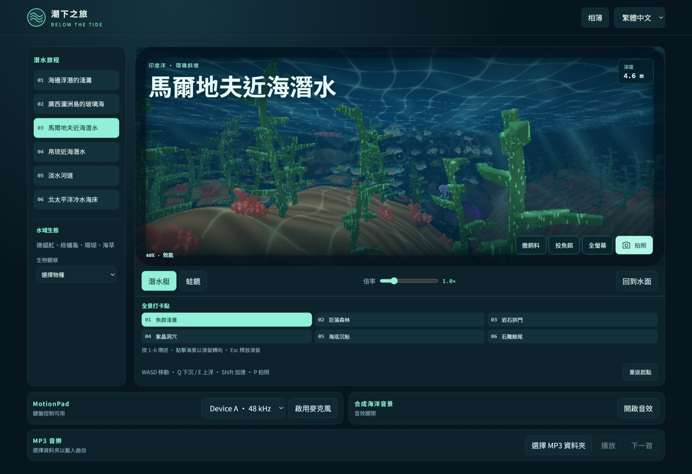

# Motion-Ocean｜潮下之旅

A web-based water/ocean journey.

在六個水域自由潛水，觀察海洋與淡水生物，並拍照留存。

## 開啟遊戲

1. 從 GitHub 下載 `index.html`，或使用 GitHub Desktop 複製此儲存庫。
2. 使用支援 WebGPU 且已啟用硬體加速的桌面瀏覽器開啟 `index.html`。

使用 `WASD` 移動、`Q` 下沉、`E` 上浮、`1–6` 前往景點、`P` 拍照。也可透過側欄的「生物觀察」前往指定物種附近。

完整操作、MotionPad 設定與技術細節見 [軟體規格書](./軟體規格書.md)。

